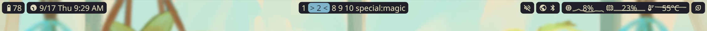

# Configuration

You can use a toml file at `$XDG_CONFIG_HOME/eucalyptus-twig/eucalyptus-twig.toml` to customize some options.

## Theme

Pick one from [Iced builtin themes](https://docs.rs/iced_core/latest/iced_core/theme/enum.Theme.html).

```toml
theme = "Kanagawa Wave"
```

## Layout

A widget can be shown independently, or grouped with other widget to create a "merged widget".



```toml
left = [
  "Power",
  "Clock",
]
middle = [
  "Workspaces",
]
right = [
  "Volume",
  # These two widgets will be shown in a same "merged widget", but still operate separately
  ["Network", "Bluetooth"],
  "SystemInformation",
  "PowerProfile",
]
```

## Widget Specific

Check if a widget has its own options [here](./widgets.md).

For example, you can set a different `format` string for the clock widget.

```toml
[widget.clock]
format = "%-m/%-d %a %-I:%M %p"
```
